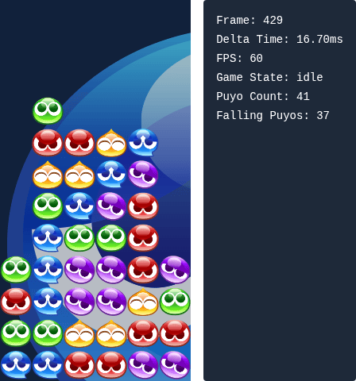

# book-puyopuyo-programming

A modern reimplementation of the Puyo Puyo Programming book examples using React, TypeScript, and Vite.

## About

This project recreates the game development tutorials from the "Puyo Puyo Programming" educational materials, rebuilt with a contemporary web development stack. The original book teaches programming concepts through building a Puyo Puyo puzzle game, and this repository provides the same learning experience using modern tools and best practices.

## Tech Stack

- React 19
- TypeScript
- Vite
- React Router
- Biome (linting and formatting)

## Prerequisites

- Node.js 26 or higher
- pnpm 12.9.0 or higher

## Getting Started

Install dependencies:

```bash
pnpm install
```

Start the development server:

```bash
pnpm dev
```

Open the URL that Vite prints. The screenshots below show the built-in sample board of this project ([`src/pages/stage05/config.ts`](src/pages/stage05/config.ts)). The images in them are SEGA game assets, under the terms in [`LICENSE_SEGA.txt`](LICENSE_SEGA.txt).

`/stage04` draws the board:


`/stage05` lets the floating puyos fall, and shows the frame, FPS and game state next to the board:



## Project Structure

```
src/           - Modern React implementation
ref/           - Reference code from the original Monaca-based book (stages 01-15)
```

## License

This repository contains code under multiple licenses:

**Reference Directory (`ref/`)**

Licensed under the "Puyo Puyo Programming" Terms of Use (`LICENSE_SEGA`). This directory contains code from the original Monaca-based materials. While each stage includes an MIT license file, all content is distributed under the SEGA terms.

**Source Code (`src/` and other files)**

Dual-licensed under Apache-2.0 (`LICENSE_APACHE_2_0`) and the "Puyo Puyo Programming" Terms of Use (`LICENSE_SEGA`). Original code written for this reimplementation is available under Apache-2.0, while game assets in the `public/img_sega` and `www` directories, and in the screenshots in `images/`, remain under the SEGA terms.
